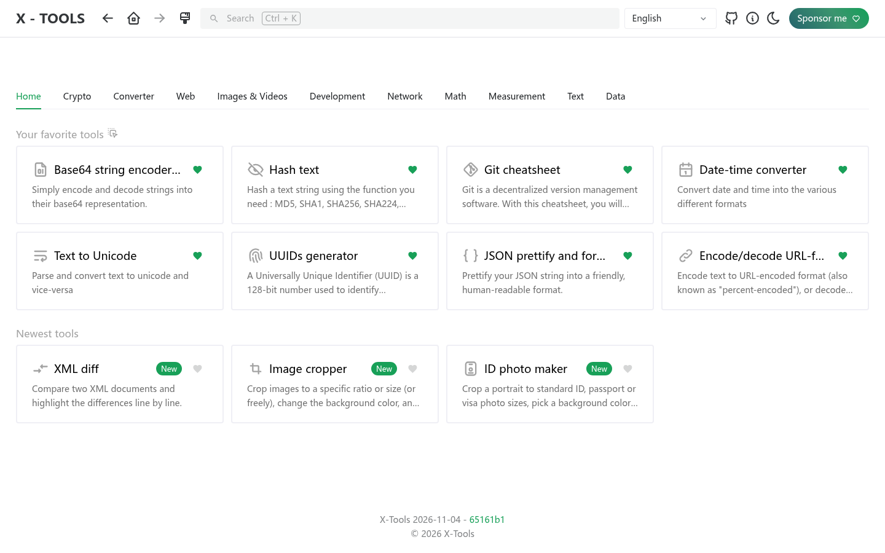
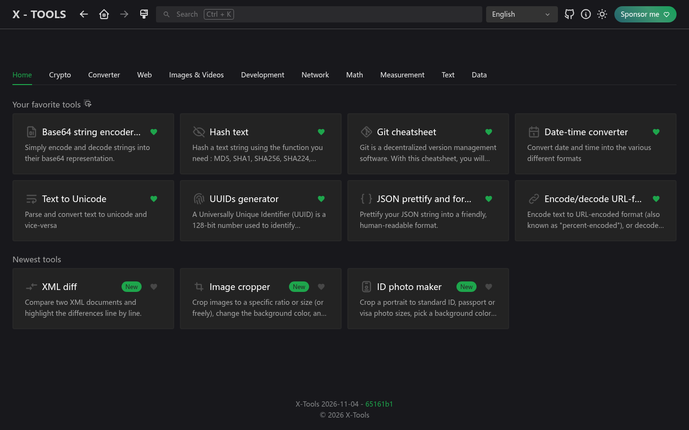
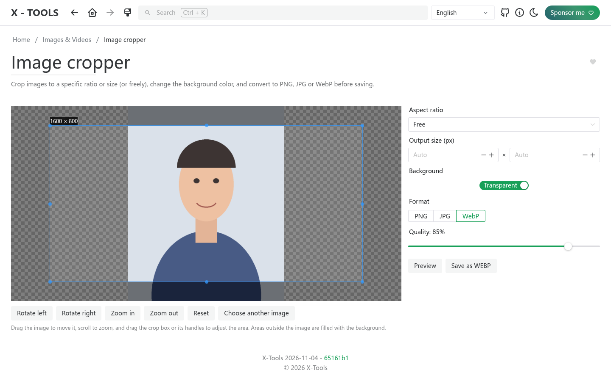
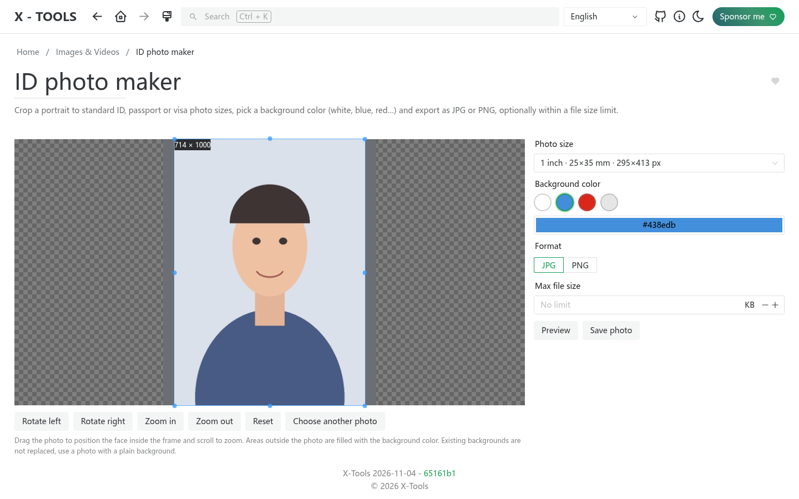
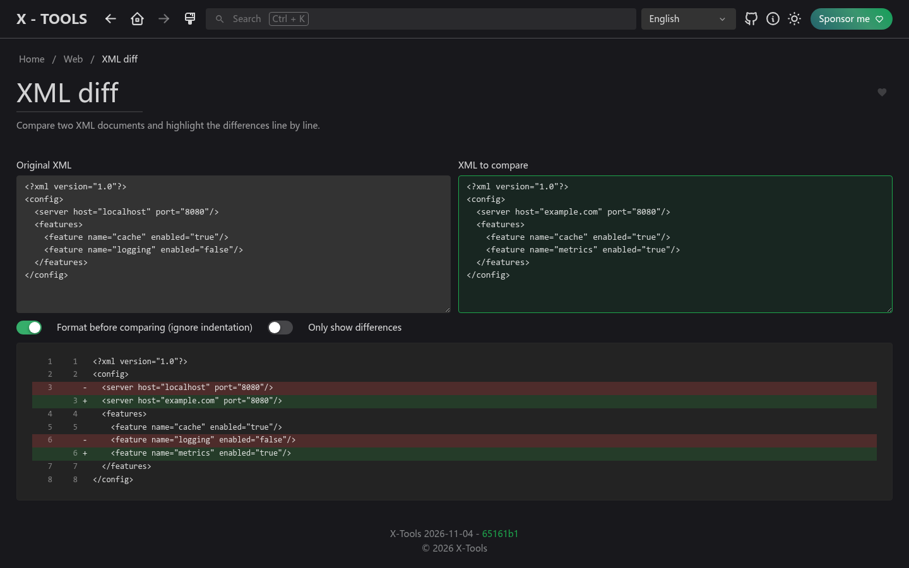

<picture>
    <source srcset="./.github/logo-dark.png" media="(prefers-color-scheme: light)">
    <source srcset="./.github/logo-white.png" media="(prefers-color-scheme: dark)">
    
</picture>

<p align="center">
  <b>IT に限らず、誰でも使える便利なオンラインツール集。</b><br>
  <a href="https://xtools.codestudio.uk">デモを試す</a> · <a href="https://afdian.com/a/waying">支援する</a>
</p>

<p align="center">
  <a href="./README.md">English</a> | <a href="./README.zh-CN.md">简体中文</a> | <a href="./README.zh-TW.md">繁體中文</a> | 日本語 | <a href="./README.ko.md">한국어</a>
</p>

## X-Tools を作った理由

[IT-Tools](https://github.com/CorentinTh/it-tools) は優れたユーティリティ集ですが、主に開発者向けです。X-Tools はそのフォークで、**IT 分野にとどまらず、日常や仕事で役立つツールをもっと増やす**ことと、ツールを見つけやすくすることを目指しています。

**今すぐ試す：[xtools.codestudio.uk](https://xtools.codestudio.uk)**

## IT-Tools からの変更点

- **新しいホーム画面**：ツールをカテゴリ別のタブで表示。ホームタブには、お気に入りのツール（ドラッグで並べ替え可能）と最新のツールが表示されます。従来のサイドバーは廃止しました。
- **新しいツール**
  - **画像トリミング**：比率や正確なサイズ（自由な指定も可）で切り抜き、背景色を変更し、PNG・JPG・WebP で書き出し。
  - **証明写真メーカー**：1 インチ、2 インチ、パスポート、ビザ（米国 2x2 インチ）などのサイズをプリセット。背景色をすぐに選べ、ファイルサイズ（KB）の上限も指定できます。
  - **XML 差分比較**：2 つの XML を行単位で比較。インデントなどの書式の違いは無視できます。
- **12 言語対応**：English、简体中文、繁體中文、日本語、한국어、Deutsch、Español、Français、Norsk、Português、Українська、Tiếng Việt。既定ではブラウザの言語を使用し、手動で選んだ言語を優先します。
- **新しいブランドとロゴ**：歯車の上で 2 本のレンチが「X」の形に交差しています。

## スクリーンショット

| ライト | ダーク |
| --- | --- |
|  |  |

| 画像トリミング | 証明写真メーカー | XML 差分比較 |
| --- | --- | --- |
|  |  |  |

## 支援のお願い

X-Tools は永久に無料のオープンソース（GPL-3.0）ですが、ホスティングとドメインの費用がかかります。役に立ったと感じたら、**[愛発電（Afdian）](https://afdian.com/a/waying)** でのご支援をご検討ください。新しいツールを追加する励みになります。ありがとうございます！

## 機能とロードマップ

実装予定の機能は [issues](https://github.com/chenguangming/x-tools/issues) をご確認ください。

ツールのアイデアがありますか？[機能リクエスト](https://github.com/chenguangming/x-tools/issues/new/choose) をお送りください！

## セルフホスト

ホームラボ向けのセルフホスト方法：

**Docker Hub から：**

```sh
docker run -d --name x-tools --restart unless-stopped -p 8080:80 wayings/x-tools:latest
```

**GitHub Packages から：**

```sh
docker run -d --name x-tools --restart unless-stopped -p 8080:80 ghcr.io/chenguangming/x-tools:latest
```

## コントリビュート

開発環境、テスト、ツールの追加方法は [English README の Contribute セクション](./README.md#contribute) を参照してください。

## クレジット

X-Tools は Corentin Thomasset 氏の [IT-Tools](https://github.com/CorentinTh/it-tools)（GPL-3.0）をもとにしています。原作者とすべてのコントリビューターに感謝します。
