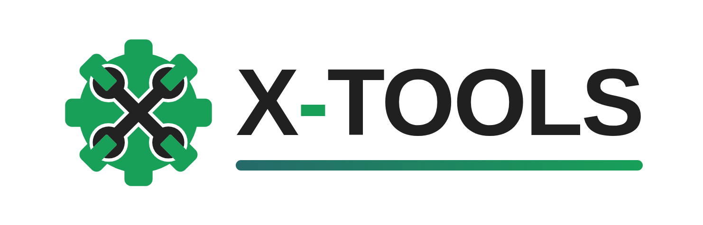
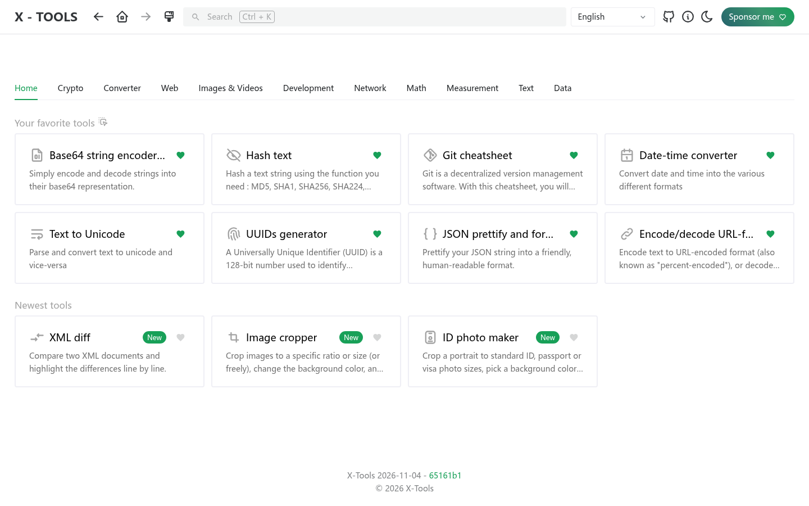
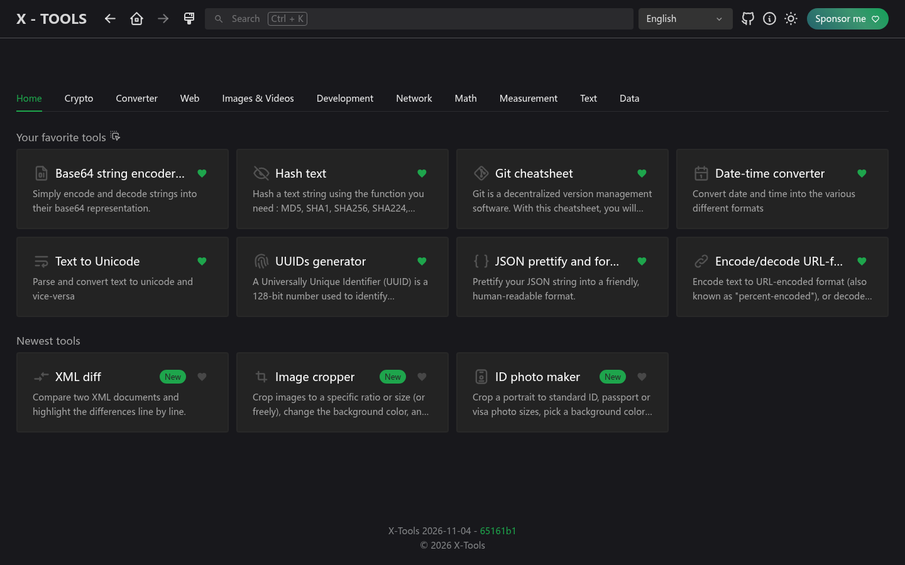
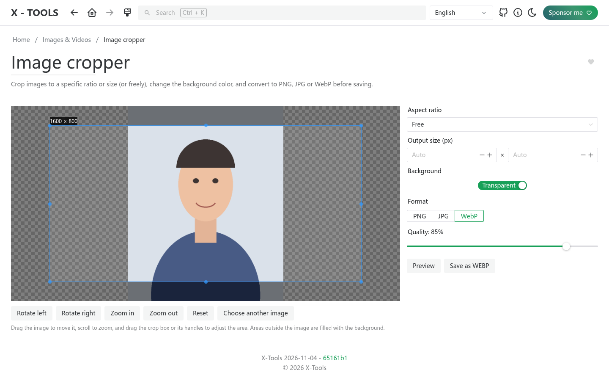
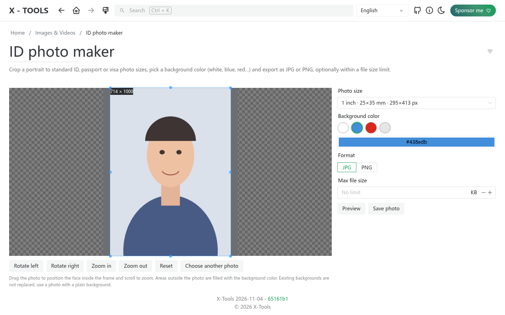
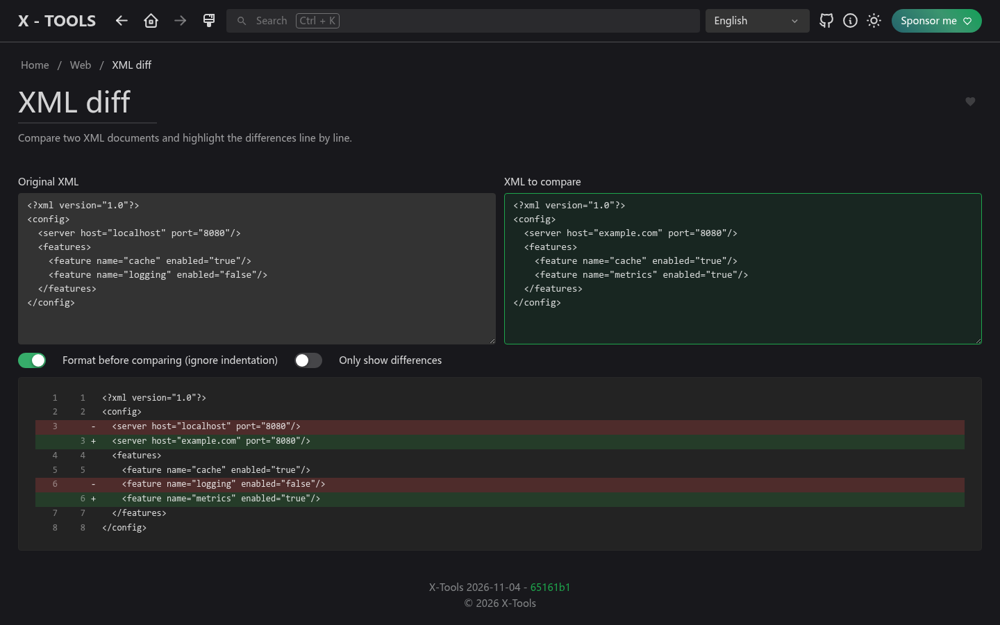

<picture>
    <source srcset="./.github/logo-dark.png" media="(prefers-color-scheme: light)">
    <source srcset="./.github/logo-white.png" media="(prefers-color-scheme: dark)">
    
</picture>

<p align="center">
  <b>IT 분야를 넘어, 누구나 쓸 수 있는 편리한 온라인 도구 모음.</b><br>
  <a href="https://xtools.codestudio.uk">데모 체험</a> · <a href="https://afdian.com/a/waying">후원하기</a>
</p>

<p align="center">
  <a href="./README.md">English</a> | <a href="./README.zh-CN.md">简体中文</a> | <a href="./README.zh-TW.md">繁體中文</a> | <a href="./README.ja.md">日本語</a> | 한국어
</p>

## X-Tools를 만든 이유

[IT-Tools](https://github.com/CorentinTh/it-tools)는 훌륭한 유틸리티 모음이지만 주로 개발자를 위한 것입니다. X-Tools는 이를 포크한 프로젝트로, **IT 분야에 국한되지 않고 일상과 업무에 쓸 수 있는 도구를 더 많이 추가**하고, 도구를 더 쉽게 찾을 수 있게 하는 것을 목표로 합니다.

**지금 체험하기: [xtools.codestudio.uk](https://xtools.codestudio.uk)**

## IT-Tools와 달라진 점

- **새로운 홈 화면**: 도구를 카테고리별 탭으로 보여 줍니다. 홈 탭에는 즐겨찾기 도구(드래그로 순서 변경 가능)와 최신 도구가 표시되며, 기존 사이드바는 없앴습니다.
- **새로운 도구**
  - **이미지 자르기**: 비율이나 정확한 크기(자유 조절도 가능)로 자르고, 배경색을 바꾸고, PNG·JPG·WebP로 내보냅니다.
  - **증명사진 만들기**: 1인치, 2인치, 여권, 비자(미국 2x2인치) 등 자주 쓰는 크기를 기본 제공하고, 브라우저에서 로컬로 동작하는 AI 자동 배경 제거를 지원하고 배경색을 바로 선택할 수 있으며 파일 크기(KB) 제한도 지정할 수 있습니다.
  - **XML 차이 비교**: 두 XML을 줄 단위로 비교하며, 들여쓰기 같은 서식 차이는 무시할 수 있습니다.
- **12개 언어**: English, 简体中文, 繁體中文, 日本語, 한국어, Deutsch, Español, Français, Norsk, Português, Українська, Tiếng Việt. 기본값은 브라우저 언어이며, 직접 선택한 언어가 우선합니다.
- **새로운 브랜드와 로고**: 톱니바퀴 위에서 두 개의 렌치가 「X」 모양으로 교차합니다.

## 스크린샷

| 라이트 | 다크 |
| --- | --- |
|  |  |

| 이미지 자르기 | 증명사진 만들기 | XML 차이 비교 |
| --- | --- | --- |
|  |  |  |

## 후원

X-Tools는 영원히 무료이며 오픈 소스(GPL-3.0)이지만, 호스팅과 도메인 갱신에 비용이 듭니다. 도움이 되었다면 **[爱发电 (Afdian)](https://afdian.com/a/waying)**을 통한 후원을 고려해 주세요. 더 많은 도구를 추가하는 데 큰 힘이 됩니다. 감사합니다!

## 기능과 로드맵

구현 예정인 기능은 [issues](https://github.com/chenguangming/x-tools/issues)에서 확인하세요.

도구 아이디어가 있나요? [기능 요청](https://github.com/chenguangming/x-tools/issues/new/choose)을 보내 주세요!

## 셀프 호스팅

홈랩을 위한 셀프 호스팅 방법:

**Docker Hub에서:**

```sh
docker run -d --name x-tools --restart unless-stopped -p 8080:80 wayings/x-tools:latest
```

**GitHub Packages에서:**

```sh
docker run -d --name x-tools --restart unless-stopped -p 8080:80 ghcr.io/chenguangming/x-tools:latest
```

## 기여하기

개발 환경, 테스트, 새 도구 추가 방법은 [English README의 Contribute 섹션](./README.md#contribute)을 참고하세요.

## 크레딧

X-Tools는 Corentin Thomasset의 [IT-Tools](https://github.com/CorentinTh/it-tools)(GPL-3.0)를 기반으로 합니다. 원작자와 모든 기여자에게 감사드립니다.
