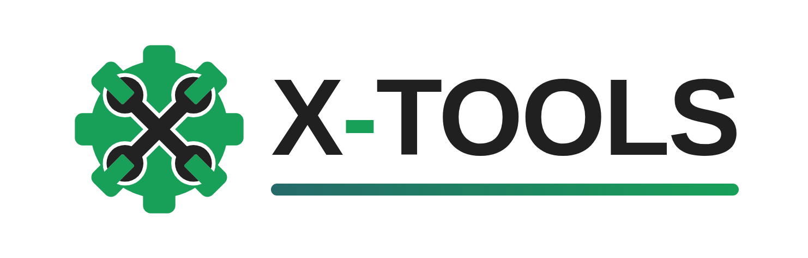
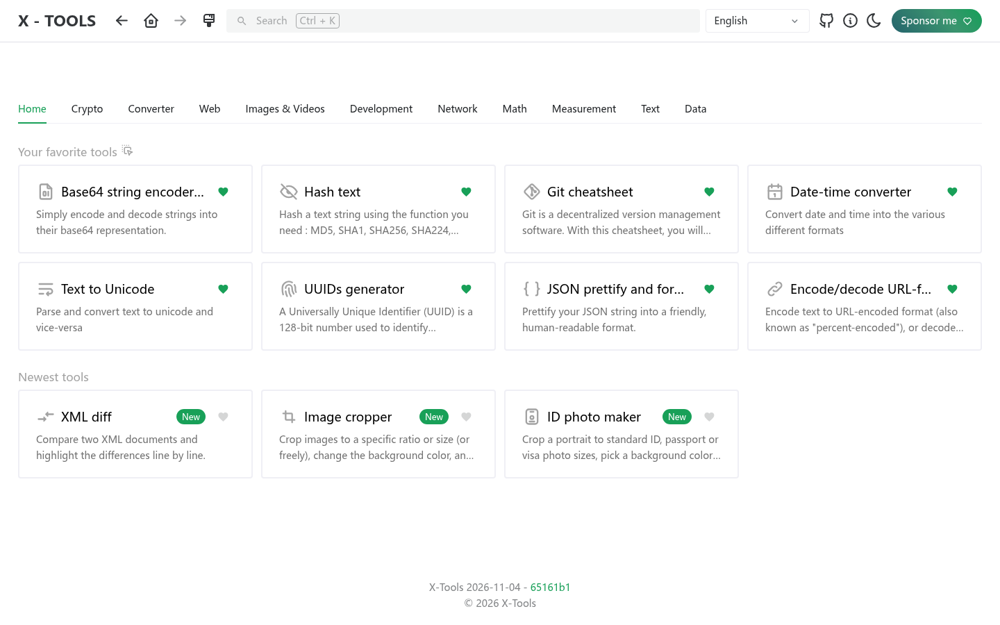
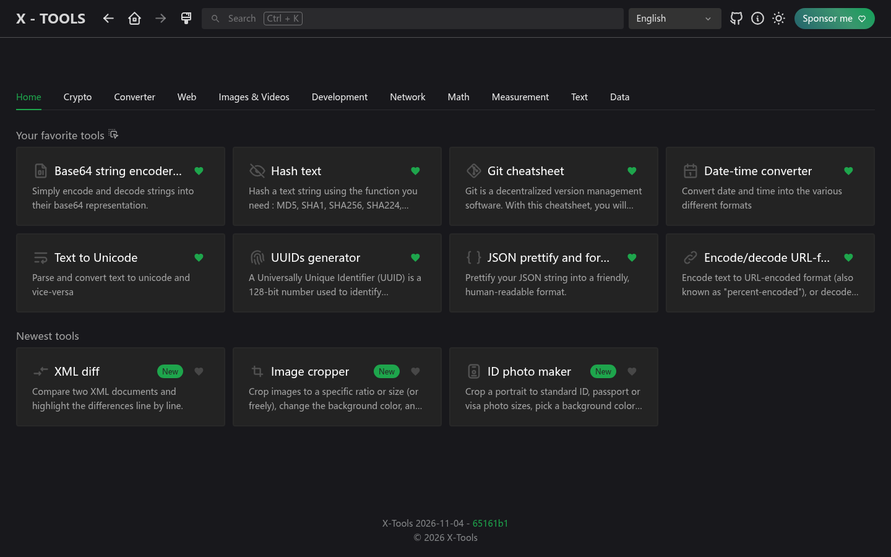
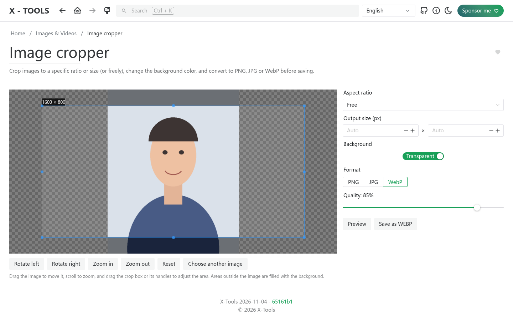
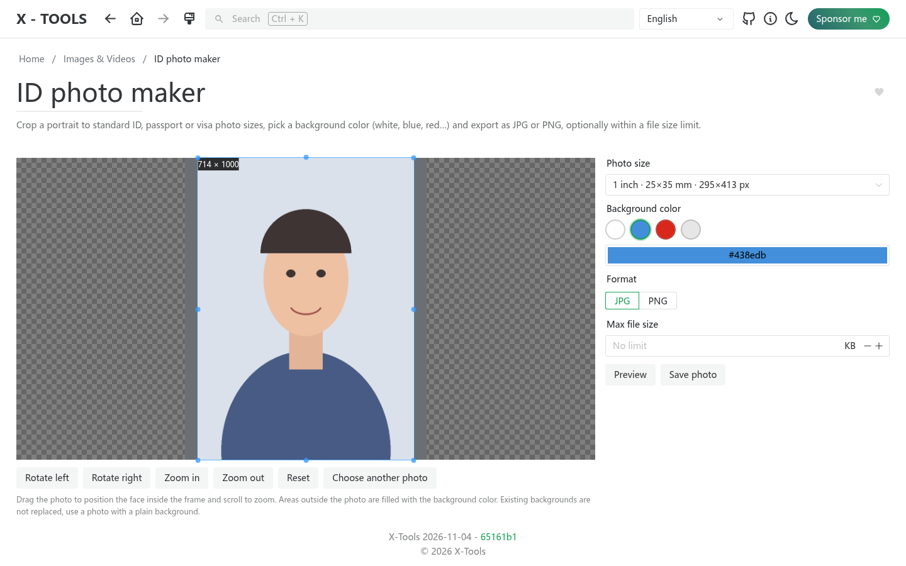
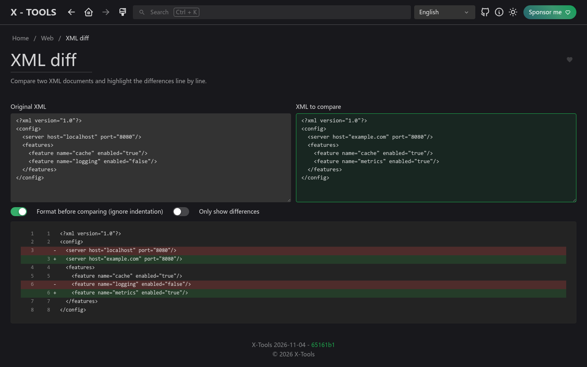

<picture>
    <source srcset="./.github/logo-dark.png" media="(prefers-color-scheme: light)">
    <source srcset="./.github/logo-white.png" media="(prefers-color-scheme: dark)">
    
</picture>

<p align="center">
  <b>Handy online tools for everyone, beyond just IT.</b><br>
  <a href="https://xtools.codestudio.uk">Live demo</a> · <a href="https://afdian.com/a/waying">Sponsor</a>
</p>

<p align="center">
  English | <a href="./README.zh-CN.md">简体中文</a> | <a href="./README.zh-TW.md">繁體中文</a> | <a href="./README.ja.md">日本語</a> | <a href="./README.ko.md">한국어</a>
</p>

## Why X-Tools

[IT-Tools](https://github.com/CorentinTh/it-tools) is a great collection of utilities, but it focuses on developers. X-Tools is a fork with a different goal: **expand the toolbox with more tools for everyday life and work, not only IT**, and make them easier to find.

**Try it now: [xtools.codestudio.uk](https://xtools.codestudio.uk)**

## What's new compared with IT-Tools

- **New home page**: tools are grouped into category tabs, and the home tab shows your favorite tools (drag to reorder) and the newest tools. The old sidebar is gone.
- **New tools**
  - **Image cropper**: crop to a ratio or exact size (or freely), change the background color, and export as PNG, JPG or WebP.
  - **ID photo maker**: preset ID, passport and visa sizes (1 inch, 2 inch, US 2x2 in...), background color swatches, and an optional maximum file size.
  - **XML diff**: compare two XML documents line by line, ignoring formatting differences.
- **12 languages**: English, 简体中文, 繁體中文, 日本語, 한국어, Deutsch, Español, Français, Norsk, Português, Українська, Tiếng Việt. The browser language is used by default, and your own choice always wins.
- **New brand and logo**: two wrenches crossed into an "X" over a gear.

## Screenshots

| Light | Dark |
| --- | --- |
|  |  |

| Image cropper | ID photo maker | XML diff |
| --- | --- | --- |
|  |  |  |

## Sponsor

X-Tools is free forever and open source (GPL-3.0), but hosting and the domain cost money. If it helps you, please consider supporting the project on **[Afdian (爱发电)](https://afdian.com/a/waying)**. It also encourages more new tools. Thank you!

## Functionalities and roadmap

Please check the [issues](https://github.com/chenguangming/x-tools/issues) to see if some feature listed to be implemented.

You have an idea of a tool? Submit a [feature request](https://github.com/chenguangming/x-tools/issues/new/choose)!

## Self host

Self host solutions for your homelab

**From docker hub:**

```sh
docker run -d --name x-tools --restart unless-stopped -p 8080:80 wayings/x-tools:latest
```

**From github packages:**

```sh
docker run -d --name x-tools --restart unless-stopped -p 8080:80 ghcr.io/chenguangming/x-tools:latest
```

## Contribute

### Recommended IDE Setup

[VSCode](https://code.visualstudio.com/) with the following extensions:

- [Volar](https://marketplace.visualstudio.com/items?itemName=Vue.volar) (and disable Vetur)
- [TypeScript Vue Plugin (Volar)](https://marketplace.visualstudio.com/items?itemName=Vue.vscode-typescript-vue-plugin).
- [ESLint](https://marketplace.visualstudio.com/items?itemName=dbaeumer.vscode-eslint)
- [i18n Ally](https://marketplace.visualstudio.com/items?itemName=lokalise.i18n-ally)

with the following settings:

```json
{
  "editor.formatOnSave": false,
  "editor.codeActionsOnSave": {
    "source.fixAll.eslint": true
  },
  "i18n-ally.localesPaths": ["locales", "src/tools/*/locales"],
  "i18n-ally.keystyle": "nested"
}
```

### Type Support for `.vue` Imports in TS

TypeScript cannot handle type information for `.vue` imports by default, so we replace the `tsc` CLI with `vue-tsc` for type checking. In editors, we need [TypeScript Vue Plugin (Volar)](https://marketplace.visualstudio.com/items?itemName=Vue.vscode-typescript-vue-plugin) to make the TypeScript language service aware of `.vue` types.

If the standalone TypeScript plugin doesn't feel fast enough to you, Volar has also implemented a [Take Over Mode](https://github.com/johnsoncodehk/volar/discussions/471#discussioncomment-1361669) that is more performant. You can enable it by the following steps:

1. Disable the built-in TypeScript Extension
   1. Run `Extensions: Show Built-in Extensions` from VSCode's command palette
   2. Find `TypeScript and JavaScript Language Features`, right click and select `Disable (Workspace)`
2. Reload the VSCode window by running `Developer: Reload Window` from the command palette.

### Project Setup

```sh
pnpm install
```

### Compile and Hot-Reload for Development

```sh
pnpm dev
```

### Type-Check, Compile and Minify for Production

```sh
pnpm build
```

### Run Unit Tests with [Vitest](https://vitest.dev/)

```sh
pnpm test
```

### Lint with [ESLint](https://eslint.org/)

```sh
pnpm lint
```

### Create a new tool

To create a new tool, there is a script that generate the boilerplate of the new tool, simply run:

```sh
pnpm run script:create:tool my-tool-name
```

It will create a directory in `src/tools` with the correct files, and a the import in `src/tools/index.ts`. You will just need to add the imported tool in the proper category and develop the tool.

## Credits

X-Tools is derived from [IT-Tools](https://github.com/CorentinTh/it-tools) by Corentin Thomasset, licensed under GPL-3.0. Many thanks to the original author and contributors.
