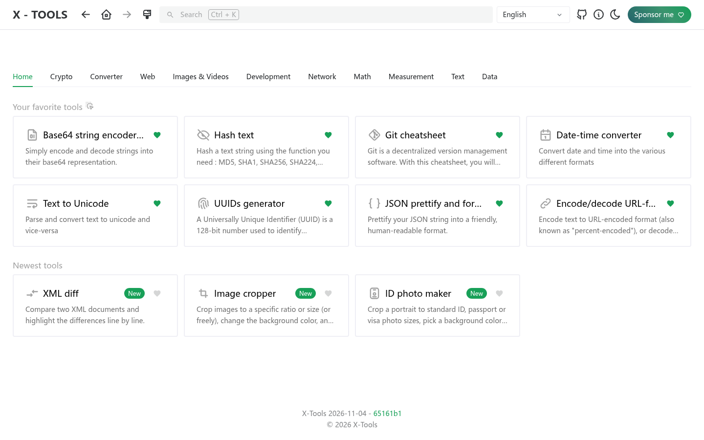
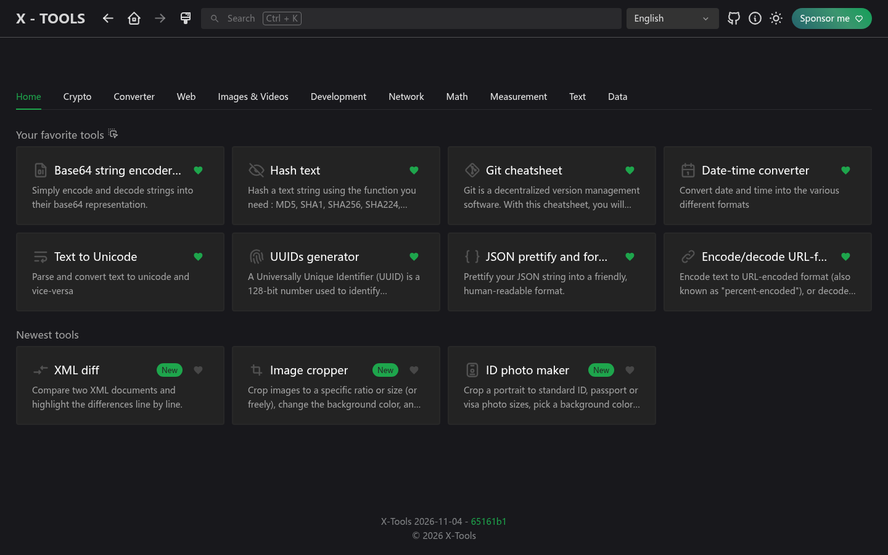
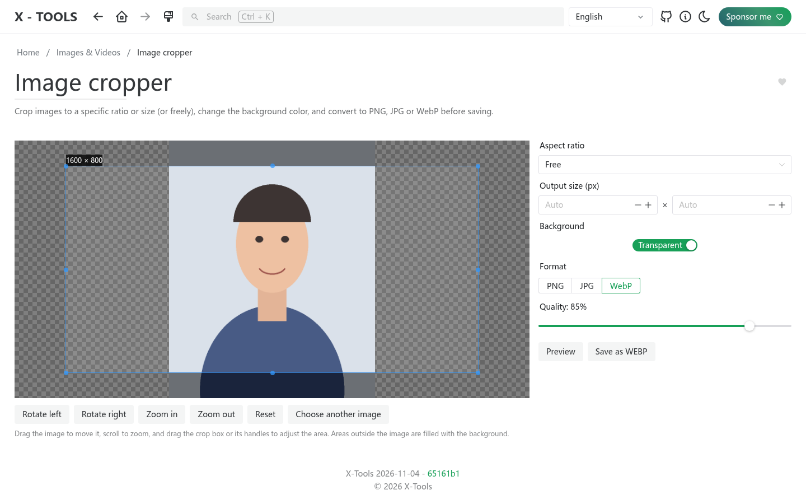
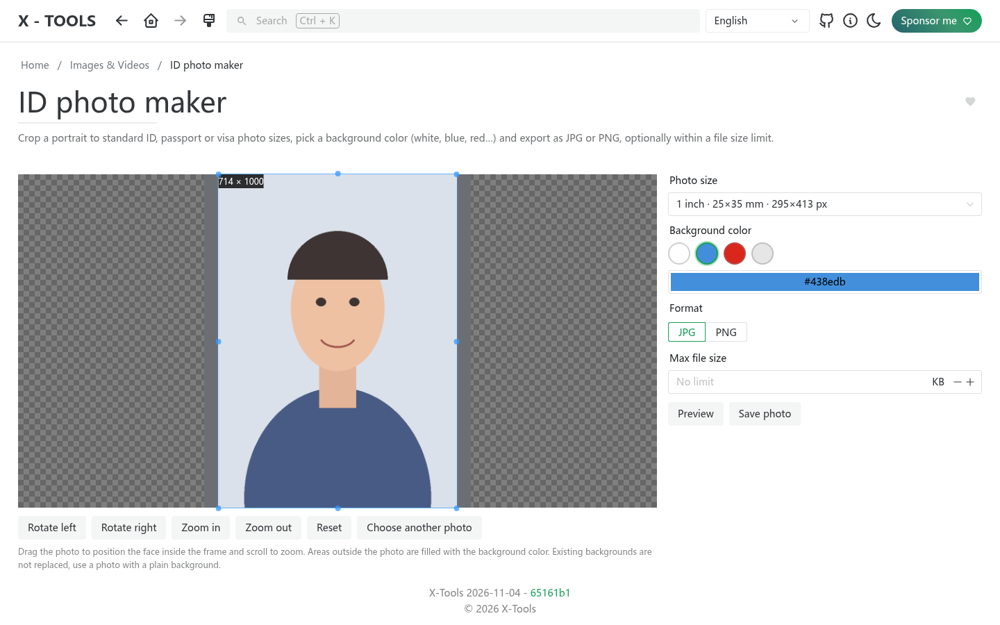
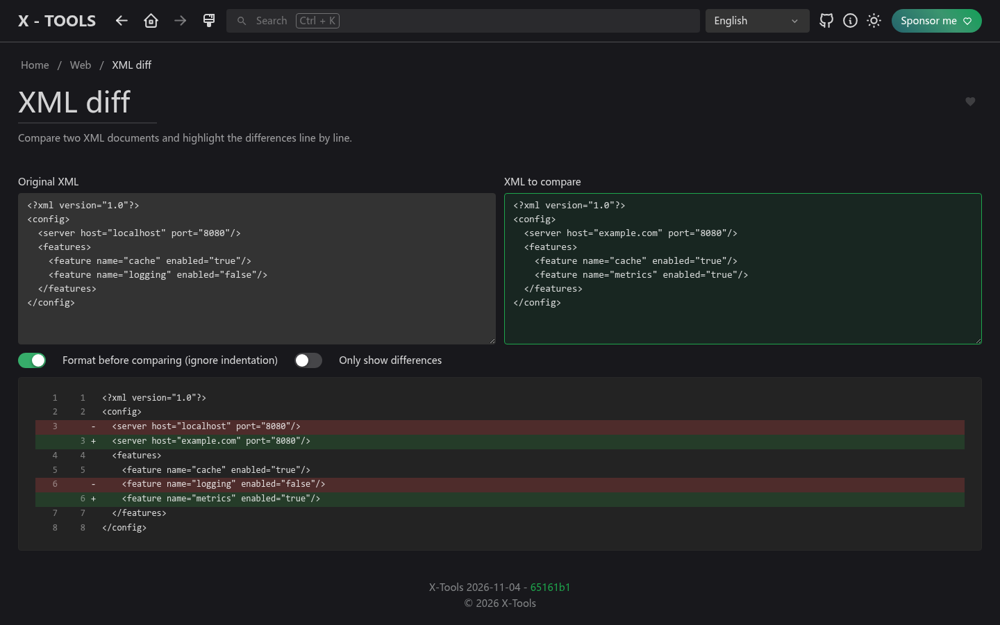

<picture>
    <source srcset="./.github/logo-dark.png" media="(prefers-color-scheme: light)">
    <source srcset="./.github/logo-white.png" media="(prefers-color-scheme: dark)">
    
</picture>

<p align="center">
  <b>人人都用得上的在线工具箱，不止于 IT。</b><br>
  <a href="https://xtools.codestudio.uk">在线体验</a> · <a href="https://afdian.com/a/waying">赞助我</a>
</p>

<p align="center">
  <a href="./README.md">English</a> | 简体中文 | <a href="./README.zh-TW.md">繁體中文</a> | <a href="./README.ja.md">日本語</a> | <a href="./README.ko.md">한국어</a>
</p>

## 为什么做 X-Tools

[IT-Tools](https://github.com/CorentinTh/it-tools) 是一个很棒的工具集，但它主要面向开发者。X-Tools 是它的二次开发版本，目标是 **拓展更多工具，覆盖日常生活与工作的各种场景，不再局限于 IT 领域**，并且让工具更容易被找到。

**立即体验：[xtools.codestudio.uk](https://xtools.codestudio.uk)**

## 相比 IT-Tools 的改动

- **全新主页**：工具按分类以 Tab 展示，主页 Tab 显示你收藏的工具（可拖拽排序）和最新工具，原来的侧边栏已取消。
- **新增工具**
  - **图片裁剪**：按比例或精确尺寸（也可自由拖动）裁剪，更换背景色，并导出为 PNG、JPG 或 WebP。
  - **证件照制作**：内置一寸、二寸、护照、签证（美国 2x2 英寸）等常用尺寸，可直接选择背景色，还能限制文件大小（KB）。
  - **XML 差异对比**：逐行对比两段 XML，可忽略缩进等格式差异。
- **12 种语言**：English、简体中文、繁體中文、日本語、한국어、Deutsch、Español、Français、Norsk、Português、Українська、Tiếng Việt。默认跟随浏览器语言，手动选择的语言优先。
- **全新品牌与 Logo**：两把扳手交叉成「X」，叠在齿轮之上。

## 界面截图

| 浅色 | 深色 |
| --- | --- |
|  |  |

| 图片裁剪 | 证件照制作 | XML 差异对比 |
| --- | --- | --- |
|  |  |  |

## 赞助支持

X-Tools 永久免费并开源（GPL-3.0），但服务器托管和域名续费需要成本。如果它对你有帮助，欢迎通过 **[爱发电](https://afdian.com/a/waying)** 赞助我，也能鼓励我添加更多工具。感谢支持！

## 功能与路线图

请查看 [issues](https://github.com/chenguangming/x-tools/issues)，了解计划中的功能。

有新工具的想法？欢迎提交 [功能请求](https://github.com/chenguangming/x-tools/issues/new/choose)！

## 自托管

适合家庭服务器（homelab）的部署方式：

**使用 Docker Hub：**

```sh
docker run -d --name x-tools --restart unless-stopped -p 8080:80 wayings/x-tools:latest
```

**使用 GitHub Packages：**

```sh
docker run -d --name x-tools --restart unless-stopped -p 8080:80 ghcr.io/chenguangming/x-tools:latest
```

## 参与贡献

开发环境、测试和新增工具的步骤请参阅 [English README 的 Contribute 部分](./README.md#contribute)。

## 致谢

X-Tools 基于 Corentin Thomasset 的 [IT-Tools](https://github.com/CorentinTh/it-tools)（GPL-3.0 许可证）二次开发，感谢原作者和所有贡献者。
