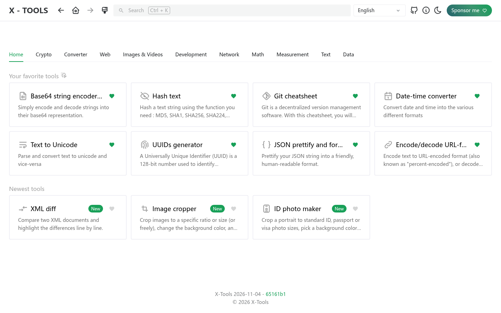
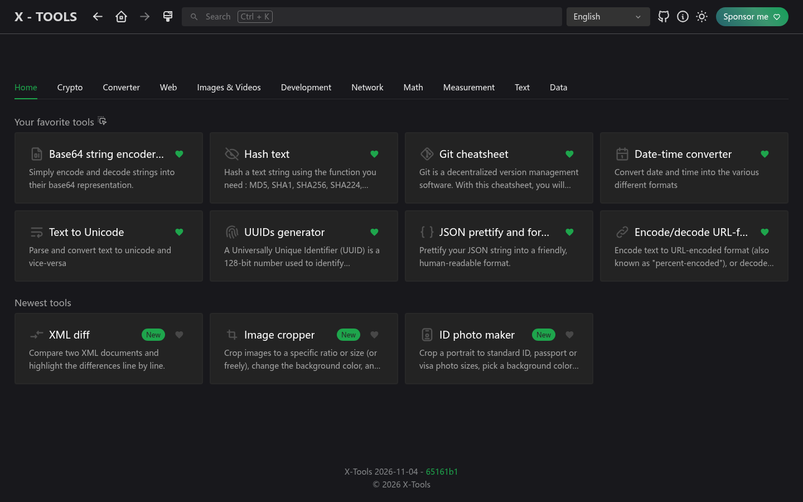
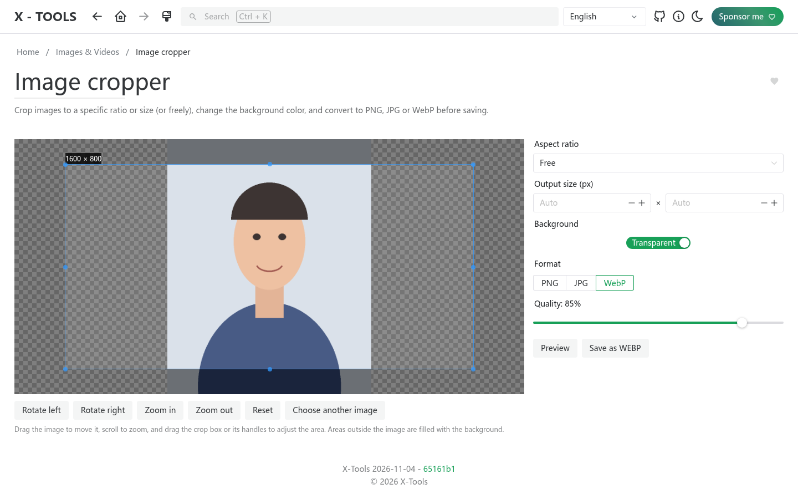
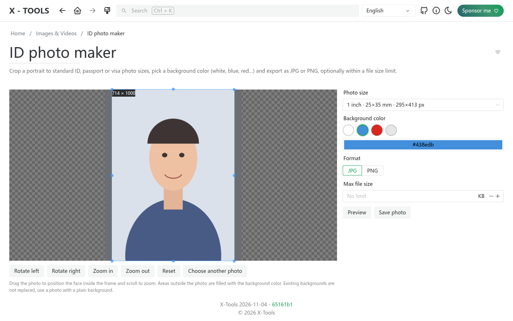
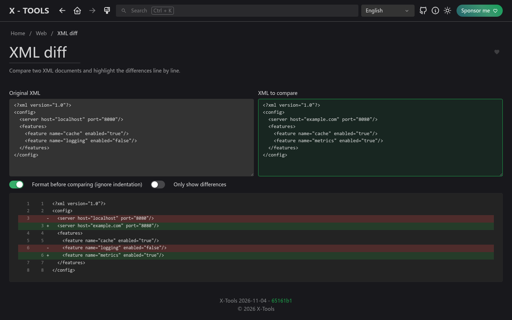

<picture>
    <source srcset="./.github/logo-dark.png" media="(prefers-color-scheme: light)">
    <source srcset="./.github/logo-white.png" media="(prefers-color-scheme: dark)">
    
</picture>

<p align="center">
  <b>人人都用得上的線上工具箱，不只是 IT。</b><br>
  <a href="https://xtools.codestudio.uk">線上體驗</a> · <a href="https://afdian.com/a/waying">贊助我</a>
</p>

<p align="center">
  <a href="./README.md">English</a> | <a href="./README.zh-CN.md">简体中文</a> | 繁體中文 | <a href="./README.ja.md">日本語</a> | <a href="./README.ko.md">한국어</a>
</p>

## 為什麼做 X-Tools

[IT-Tools](https://github.com/CorentinTh/it-tools) 是一個很棒的工具集，但主要面向開發者。X-Tools 是它的二次開發版本，目標是 **擴充更多工具，涵蓋日常生活與工作的各種情境，不再侷限於 IT 領域**，並讓工具更容易被找到。

**立即體驗：[xtools.codestudio.uk](https://xtools.codestudio.uk)**

## 相較 IT-Tools 的改動

- **全新首頁**：工具依分類以分頁顯示，首頁分頁呈現你收藏的工具（可拖曳排序）與最新工具，原本的側邊欄已移除。
- **新增工具**
  - **圖片裁切**：依比例或精確尺寸（也可自由拖曳）裁切，更換背景色，並匯出為 PNG、JPG 或 WebP。
  - **證件照製作**：內建一吋、兩吋、護照、簽證（美國 2x2 英寸）等常用尺寸，支援自動去背換背景（AI 在瀏覽器本機執行），可直接選擇背景色，還能限制檔案大小（KB）。
  - **XML 差異比對**：逐行比對兩段 XML，可忽略縮排等格式差異。
- **12 種語言**：English、简体中文、繁體中文、日本語、한국어、Deutsch、Español、Français、Norsk、Português、Українська、Tiếng Việt。預設跟隨瀏覽器語言，手動選擇的語言優先。
- **全新品牌與 Logo**：兩把扳手交叉成「X」，疊在齒輪之上。

## 介面截圖

| 淺色 | 深色 |
| --- | --- |
|  |  |

| 圖片裁切 | 證件照製作 | XML 差異比對 |
| --- | --- | --- |
|  |  |  |

## 贊助支持

X-Tools 永久免費並開源（GPL-3.0），但伺服器託管與網域續約需要成本。如果它對你有幫助，歡迎透過 **[愛發電](https://afdian.com/a/waying)** 贊助我，也能鼓勵我新增更多工具。感謝支持！

## 功能與路線圖

請查看 [issues](https://github.com/chenguangming/x-tools/issues)，了解規劃中的功能。

有新工具的想法？歡迎提交 [功能請求](https://github.com/chenguangming/x-tools/issues/new/choose)！

## 自行架設

適合家用伺服器（homelab）的部署方式：

**使用 Docker Hub：**

```sh
docker run -d --name x-tools --restart unless-stopped -p 8080:80 wayings/x-tools:latest
```

**使用 GitHub Packages：**

```sh
docker run -d --name x-tools --restart unless-stopped -p 8080:80 ghcr.io/chenguangming/x-tools:latest
```

## 參與貢獻

開發環境、測試與新增工具的步驟，請參閱 [English README 的 Contribute 部分](./README.md#contribute)。

## 致謝

X-Tools 基於 Corentin Thomasset 的 [IT-Tools](https://github.com/CorentinTh/it-tools)（GPL-3.0 授權）二次開發，感謝原作者與所有貢獻者。
